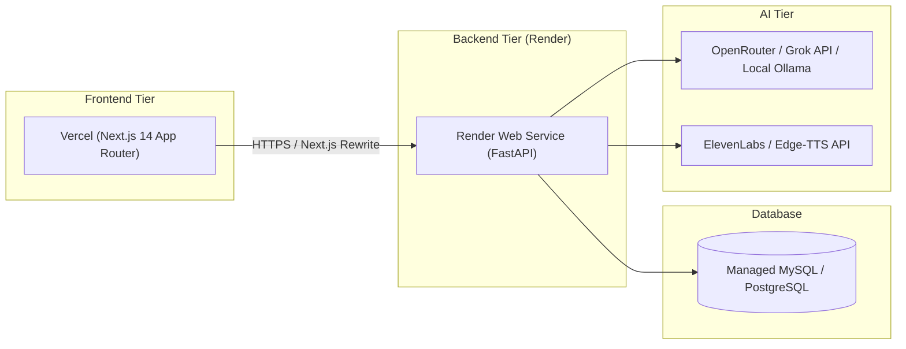
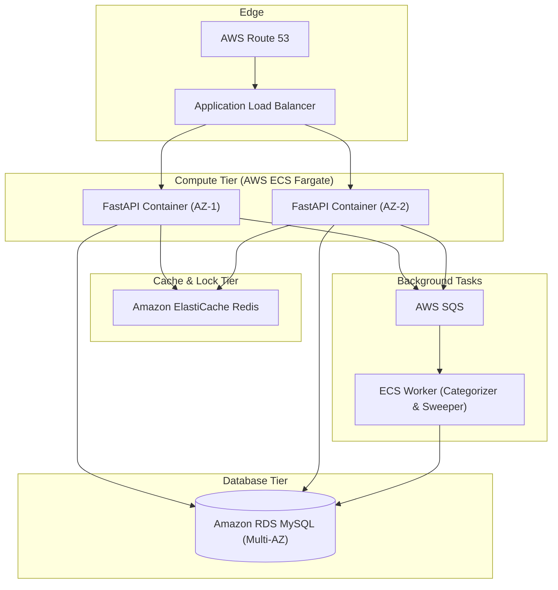
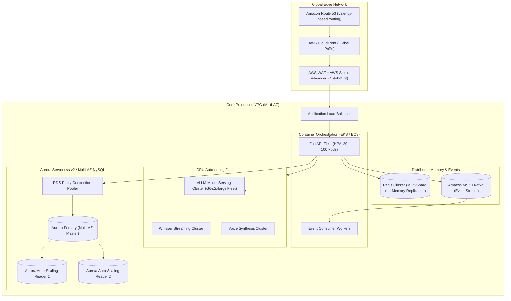

# Scalable AI FinTech Architecture & Evolution Roadmap
### From MVP to 1 Million+ Users

This document outlines the senior architectural design, infrastructure evolution, and engineering roadmap for scaling the **Wallet** platform from an MVP (100–1,000 users) up to an enterprise-grade financial system serving **1 Million+ registered users**.

---

## 1. Demystifying the "1 Million Users" Metric

In high-concurrency financial engineering, raw registered user count does not dictate server infrastructure. Architecture is engineered around **concurrent users**, **requests per second (RPS)**, and **GPU inference saturation**.

| Metric | Typical Scale | Architectural Impact |
| :--- | :--- | :--- |
| **1M Registered Users** | Total database records | Storage volume, user indexing, cold data retention |
| **100K Daily Active Users (DAU)** | Active daily sessions | Connection pool sizing, cache eviction policies |
| **10K Concurrent Users (CCU)** | Users interacting simultaneously | API horizontal scaling, WebSocket/Voice session memory |
| **1K Requests/Sec (RPS)** | Sustained HTTP/RPC load | Load balancing, database read replicas, Redis caching |
| **100–250 Concurrent Voice/AI** | Real-time speech & reasoning | Dedicated GPU worker cluster, vLLM/Triton batching |

---

## 2. Master Target Architecture (1 Million+ Users)

The golden rule of FinTech AI platforms is **strict workload isolation**:
> **The AI inference cluster must never share compute or connection pools with the deterministic transaction ledger.** A surge in conversational AI or voice streaming must never delay or degrade financial authorization and ledger state.


---

## 3. Four-Phase Scaling Evolution Roadmap

---

### Phase 1: MVP & Early Adopters (100 – 1,000 Users)

**Focus**: Fast feature validation, low operational cost, zero maintenance overhead.



- **Frontend**: Deployed on **Vercel** with automatic global CDN caching and edge headers.
- **Backend**: Single or dual-instance **Render Web Service** running FastAPI with Uvicorn.
- **Database**: Single **Managed MySQL / PostgreSQL** instance on Render or PlanetScale with daily automated backups.
- **AI Processing**: Cloud API fallback (Grok / OpenRouter) or local single-worker Ollama instance; Cloud voice (ElevenLabs / Edge-TTS).
- **Bottlenecks at this tier**: Render web service CPU limits on audio transcoding; single DB connection saturation past 1,000 active sessions.

---

### Phase 2: Product-Market Fit & Cloud Migration (1,000 – 10,000 Users)

**Focus**: High availability, session caching, distributed locks, database point-in-time recovery.



- **Compute**: Migration to **AWS ECS Fargate** with multi-AZ container deployments (2–4 instances minimum).
- **Database**: **Amazon RDS MySQL Multi-AZ** deployment with automated automated snapshots and Point-in-Time Recovery (PITR).
- **Caching & Locks**: **Amazon ElastiCache Redis** for distributed idempotency keys, rate limiting, and balance caching.
- **Background Jobs**: **AWS SQS** queue for asynchronous transaction categorization, email/SMS receipts, and event publishing.

---

### Phase 3: High-Scale & Concurrency (10,000 – 100,000 Users)

**Focus**: Read/write database split, dedicated GPU inference pool, latency reduction.


- **Read/Write DB Splitting**:
  - Primary RDS instance handles strict write transactions (`BEGIN ... COMMIT`).
  - Read replicas handle read-heavy queries (`GET /history`, `GET /users/{id}/requests`, balance timeline, and analytics).
- **Dedicated GPU Worker Fleet**:
  - Transition from local/external Ollama to dedicated **EC2 G5 (NVIDIA A10G)** or **G6 (NVIDIA L4)** GPU instances.
  - Serving LLM inference with **vLLM** for continuous batching and PagedAttention (10x throughput over Ollama).
  - Faster-Whisper running on dedicated GPU workers with sub-150ms transcription latency.
- **AI Gateway**: Implements circuit breakers. If GPU load spikes, fallback to deterministic regex or cloud fallback (Grok/OpenRouter) ensures zero transaction degradation.

---

### Phase 4: Enterprise Hyper-Scale (100,000 – 1,000,000+ Users)

**Focus**: Multi-region resilience, sub-50ms API response, automated elasticity, zero-downtime ledger.



- **Database**: **Amazon Aurora Serverless v2** with **RDS Proxy**, auto-scaling compute up to 128 ACUs per instance and multi-AZ failover in < 15 seconds.
- **Event-Driven Ledger**: Financial ledger events are published to **Amazon MSK (Kafka)** or SQS FIFO for asynchronous reconciliation, risk scoring, audit logging, and push notifications.
- **Dynamic GPU Auto-Scaling**: LLM and speech worker pools scale horizontally based on queue depth and GPU memory utilization metrics.

---

## 4. DeepSeek 16B & AI Inference Production Strategy

### Why Model Specialization Matters
While `deepseek-coder-v2:16b` is an exceptional coding model, using a code-specialized model for production FinTech NLU has tradeoffs:
1. **Instruction Alignment vs Code Synthesis**: Financial intent parsing requires precise entity extraction (amounts, counterparties, currencies) and strict structured JSON without hallucinations.
2. **Production Recommendation**:
   - For Intent Parsing & Guardrails: **Qwen 2.5 14B / 32B Instruct** or **DeepSeek-V3** via API or dedicated vLLM.
   - For Real-Time Voice: Faster-Whisper (STT) + ElevenLabs / Qwen3-TTS (TTS) deployed in parallel worker containers.

### High-Throughput Serving Architecture
```text
FastAPI Instance 1 ──┐
FastAPI Instance 2 ──┼──> [ AI Gateway ] ─── Round Robin ───> [ vLLM GPU Worker Pool ]
FastAPI Instance N ──┘     │ (Token Bucket & Fallback)           ├── Worker 1 (NVIDIA L4)
                           │                                     ├── Worker 2 (NVIDIA L4)
                           └── Failure / Saturation ──> Grok / OpenRouter API
```

Using **vLLM** instead of standard Ollama in production unlocks:
- **PagedAttention**: Reduces KV-cache memory waste by up to 80%.
- **Continuous Batching**: Processes multiple concurrent user voice requests simultaneously on a single GPU.
- **OpenAI-Compatible API**: Drop-in replacement for the existing `httpx` streaming client in `backend/app/llm.py`.

---

## 5. Technology Stack Mapping by Scale

| Component | MVP (100 – 1K) | Mid Scale (10K) | Enterprise (1M+) |
| :--- | :--- | :--- | :--- |
| **Frontend Hosting** | Vercel | Vercel / AWS CloudFront | CloudFront + S3 Origin |
| **API Backend** | Render Web Service | AWS ECS Fargate | AWS ECS / EKS (Auto-scaling) |
| **Database** | Render MySQL | Amazon RDS MySQL Multi-AZ | Aurora MySQL + RDS Proxy |
| **Caching & Locking** | In-Memory Python Dict | ElastiCache Redis (Single node) | ElastiCache Redis Cluster (Multi-AZ) |
| **LLM Inference** | Ollama / Grok API | EC2 G5 (A10G) vLLM | Auto-scaling G6e Fleet / vLLM |
| **STT Engine** | Local Faster-Whisper | Dedicated Worker (T4/L4) | Triton Inference Server (GPU Batch) |
| **TTS Engine** | ElevenLabs / Edge-TTS | Dedicated Qwen3 Worker | Parallel GPU Workers + ElevenLabs |
| **Message Queue** | In-Memory EventBus | AWS SQS FIFO | SQS FIFO + Amazon MSK (Kafka) |
| **Security & Firewall** | Standard CORS / HTTPS | AWS WAF + ALB | AWS WAF + Shield Advanced + KMS |
| **Observability** | Render logs | CloudWatch + Sentry | OpenTelemetry + Prometheus/Grafana |

---

## 6. The 5 Core Engineering Priorities for FinTech Scale

### 1. Completely Stateless Backend
- Keep zero session state, user tokens, or pending transaction memory in FastAPI process RAM.
- All state must reside in Redis (ephemeral/locks) or MySQL (authoritative ledger). Any container can be killed or spun up instantly.

### 2. Absolute Database Consistency & ACID Idempotency
- Every financial mutation must run inside an explicit database transaction (`BEGIN ... COMMIT`) with row-level locks (`SELECT FOR UPDATE`).
- Double-entry ledger invariants: Debit $\equiv$ Credit.
- Distributed idempotency: Protect every transaction with `UNIQUE(initiator_user_id, idempotency_key)` and a distributed Redis lock to prevent double-spending during network retries.

### 3. Strict AI Isolation
- The AI assistant understands language; the deterministic transaction engine owns the ledger.
- If the AI cluster is down or overwhelmed, core banking functions (Send, Request, Pay Bill, Balance) must still operate at 100% capacity via UI controls or deterministic rules.

### 4. Deep Observability & SLIs
- Monitor p50, p95, and p99 latency for both API responses and AI inference.
- Alert thresholds:
  - API Latency $> 500\text{ms}$
  - Failed transaction rate $> 0.1\%$
  - GPU VRAM saturation $> 90\%$
  - DB Connection pool utilization $> 80\%$

### 5. Disaster Recovery & Compliance
- **RPO (Recovery Point Objective)** $< 1$ minute: Automated WAL replication and streaming binary logs.
- **RTO (Recovery Time Objective)** $< 15$ minutes: Infrastructure defined via Terraform / CloudFormation for 1-click redeployment.
- Point-in-time recovery enabled with 35-day backup retention.

---

## 7. Load Testing & Verification Plan

Before transitioning between architecture tiers, validate capacity using realistic load tests.

### Concurrency Simulation Targets
- **Tier 1 (Render)**: 50 concurrent users, 50 RPS.
- **Tier 2 (ECS + Redis)**: 500 concurrent users, 250 RPS.
- **Tier 3 (Multi-instance + GPU)**: 2,500 concurrent users, 1,000 RPS.
- **Tier 4 (Aurora + vLLM cluster)**: 10,000 concurrent users, 5,000 RPS.

### Example k6 Load Testing Script (`load_test.js`)
```javascript
import http from 'k6/http';
import { check, sleep } from 'k6';

export const options = {
  stages: [
    { duration: '1m', target: 200 },   // Ramp-up to 200 users
    { duration: '3m', target: 1000 },  // Sustained load at 1,000 users
    { duration: '1m', target: 0 },     // Ramp-down
  ],
  thresholds: {
    http_req_duration: ['p(95)<350'],  // 95% of requests must complete under 350ms
    http_req_failed: ['rate<0.001'],   // Error rate must be under 0.1%
  },
};

export default function () {
  const url = 'http://127.0.0.1:8000/agent/act';
  const payload = JSON.stringify({
    user_id: 1,
    text: 'What is my current balance?',
    idempotency_key: `load-${Date.now()}-${__VU}-${__ITER}`,
  });

  const params = {
    headers: { 'Content-Type': 'application/json' },
  };

  const res = http.post(url, payload, params);
  check(res, {
    'status is 200': (r) => r.status === 200,
    'has valid response': (r) => r.json().text !== undefined,
  });

  sleep(1);
}
```

---

## 8. Summary & Immediate Next Steps

1. **Today**: Current code uses modular, stateless FastAPI routers, centralized SQLAlchemy models, and clean service boundaries (`assistant_db.py`, `engine.py`, `llm.py`).
2. **Next Step (1K–10K)**: Introduce Redis for idempotency key storage and rate limiting, containerize via Docker, and configure ECS Fargate task definitions.
3. **GPU Step (10K+)**: Package Faster-Whisper and vLLM inside an EC2 G5/G6 instance behind the AI Gateway, preserving the current fallback mechanism.
